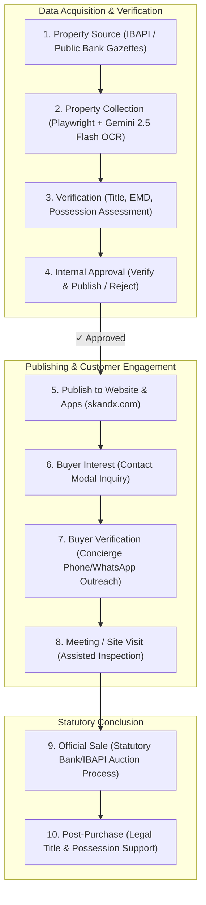
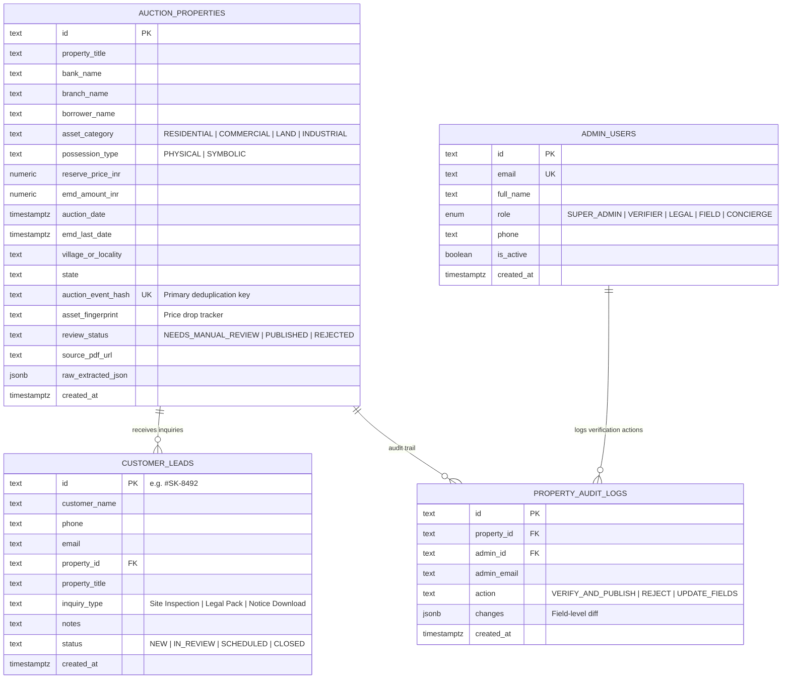

# Phase 1 Deliverable: Planning, Requirements & UI/UX Specification

> **Project**: Verified Distressed Property Discovery & Buyer Assistance Platform (SKANDX)  
> **Milestone**: Phase 1 (Days 1–10) | **Milestone Payment Due**: 10% (₹15,000 – ₹17,500)  
> **Deliverable Scope**: Requirements confirmation, user roles & permissions, database structure & ER diagram, UI/UX design (Web + Mobile), property verification & buyer workflow, technical architecture, and phase-end draft/demo.  
> **Status**: **100% Completed & Ready for Client Approval**  
> **Date**: November 2026  

---

## 1. Phase 1 Deliverables Verification Matrix

| # | Proposal Requirement | Deliverable Output in Codebase | Status |
| :-: | :--- | :--- | :---: |
| **1** | **Requirement Confirmation & Business Workflow** | 10-Stage end-to-end distressed asset lifecycle documented in Section 2 | ✅ **COMPLETE** |
| **2** | **User Roles & Permission Planning** | 7 primary user roles with granular CRUD matrix in Section 3 & DDL migration `003` | ✅ **COMPLETE** |
| **3** | **Database Structure & ER Diagram** | 33-attribute property table, customer leads, admin users, audit log & visual Mermaid ER diagram in Section 4 | ✅ **COMPLETE** |
| **4** | **UI/UX Design for Website & Mobile** | Luxury dark navy/gold responsive SPA built in React 19 + Vite (supporting Web, Android, iOS viewports) | ✅ **COMPLETE** |
| **5** | **Property Verification & Buyer Workflow** | Dual-subdomain architecture (`skandx.com` vs `admin.skandx.com`), split-pane notice verification desk & inquiry lead engine | ✅ **COMPLETE** |
| **6** | **Technical Architecture & Implementation Plan** | REST API service, Pydantic schemas, Playwright scraper & Gemini 2.5 Flash OCR engine documented in Section 6 | ✅ **COMPLETE** |
| **7** | **Phase-End Draft / Demo Presentation** | Live clickable application with 1-Click Test Mode bypass for frictionless evaluation | ✅ **COMPLETE** |

---

## 2. Main Business Workflow (10-Stage Lifecycle)

The platform operates as an institutional discovery and buyer-assistance service. The statutory sale remains with the bank, preserving full legal compliance:



1. **Property Source**: Automated crawlers identify scheduled SARFAESI auctions from authorized public bank sources.
2. **Property Collection**: Raw notice PDFs and newspaper scans are ingested and routed to Gemini 2.5 Flash Vision OCR.
3. **Verification**: Extraction of 33 key fields: Reserve Price, 10% EMD, survey numbers, auction deadlines, and possession type.
4. **Internal Approval**: Bank recovery officers review OCR results against the original notice PDF and approve or reject listings.
5. **Publish**: Verified listings go live on `skandx.com` with a green `✓ Verified` badge.
6. **Buyer Interest**: Buyers click **Contact** to request legal title packs, site inspections, or notice PDFs.
7. **Buyer Verification**: Concierge team reviews buyer readiness and budget suitability.
8. **Meeting / Visit**: Direct liaison with the bank branch officer to schedule physical property inspection.
9. **Official Sale**: Buyer deposits 10% EMD directly to the bank and bids on the official statutory auction portal.
10. **Post-Purchase**: Optional assistance with Sale Certificate issuance, registration, and Section 14 CMM orders.

---

## 3. User Roles & Permission Planning Matrix (Proposal Section 7)

Seven distinct user roles ensure clear segregation of duties across the organization:

| Role | Target Department | System Access Scope | Permitted Actions |
| :--- | :--- | :--- | :--- |
| **Super Admin** | Executive Management | Full System (All Portals) | Manage staff accounts, assign roles, override verification decisions, view full audit trail logs. |
| **Property / Acquisition** | Data Operations | Ingestion & Sources | Trigger crawlers, upload raw auction notice PDFs, record source URLs and bank contact points. |
| **Verification Officer** | Back-Office Verification | Verification Desk | Compare OCR fields against PDF circular, edit asset attributes, click **Verify & Publish** or **Reject**. |
| **Legal Reviewer** | Legal Department | Legal Verification | Audit encumbrances, review DRT / SARFAESI dispute history, attach legal notes and risk tags. |
| **Field Executive** | Ground Operations | Field Inspection | Upload physical site visit photographs, record neighborhood notes, confirm physical vs symbolic possession. |
| **Relationship / Buyer Team** | Concierge Desk | Leads & Inquiries | Receive customer leads, contact buyers within 15 minutes, log notes, update status (`NEW` $\rightarrow$ `SCHEDULED`). |
| **Customer / Buyer** | General Public | Public Marketplace | Search bank listings, filter by budget/bank/location, download notice summaries, submit inquiries. |

---

## 4. Database Structure & Visual ER Diagram

The database is designed in PostgreSQL (Supabase) with strict Row Level Security (RLS) policies:

### 4.1 Visual Entity-Relationship (ER) Diagram



### 4.2 Database Migrations Index
- [001_create_auction_properties.sql](file:///c:/Users/rajkr/Documents/code-base/real%20estate/backend/migrations/001_create_auction_properties.sql): 33 statutory SARFAESI attributes + RLS public read filter.
- [002_create_customer_leads.sql](file:///c:/Users/rajkr/Documents/code-base/real%20estate/backend/migrations/002_create_customer_leads.sql): Inquiries table with generated reference IDs (`#SK-XXXX`) and RLS public insert.
- [003_create_admin_roles_and_audit.sql](file:///c:/Users/rajkr/Documents/code-base/real%20estate/backend/migrations/003_create_admin_roles_and_audit.sql): Role-based admin users, audit logging, and seed accounts.

---

## 5. UI/UX Design System Specification

### 5.1 Color Palette & Tokens
* **Navy Background**: `#071D35` / `#0A2540` (Conveys institutional security and banking trust).
* **Gold Primary**: `#D9A62E` / `#E8B849` (Represents premier auction opportunities).
* **Emerald Verified Badge**: `#16A34A` / `#22C55E` (Certifies bank notice has passed human legal verification).
* **Warning / EMD Deadline**: `#D97706` / `#F59E0B` (Alerts buyers to upcoming statutory cutoff dates).

### 5.2 Responsive Layout Breakpoints
* **Desktop (>1024px)**: Full multi-column grid, split-pane PDF verification desk, comprehensive property filter bar.
* **Tablet (768px – 1024px)**: Collapsible sidebar, adaptive cards with touch targets, flexible modal sheets.
* **Mobile (<768px)**: Native app experience with bottom navigation bar, touch-friendly inquiry sheet, mobile search drawer.

---

## 6. Technical Architecture & Security Model

```text
┌──────────────────────────────────────────────────────────────────────────────────────────────────┐
│                                       SKANDX CLOUD ECOSYSTEM                                     │
│                                                                                                  │
│   ┌──────────────────────────────────────────────────────────────────────────────────────────┐   │
│   │                        Unified React 19 SPA Deployment (Vercel)                          │   │
│   │   Incoming Request ──► [ Subdomain Router (domain.js) ]                                  │   │
│   │                                │                                                         │   │
│   │               ┌────────────────┴────────────────┐                                        │   │
│   │               ▼                                 ▼                                        │   │
│   │   [ Customer Marketplace ]           [ Admin Verification Desk ]                         │   │
│   │   • Host: skandx.com                 • Host: admin.skandx.com                            │   │
│   │   • Verified assets filter           • Session-authenticated gate                        │   │
│   │   • Inquiries & WhatsApp routing     • Split-pane PDF verification                       │   │
│   └───────────────┬─────────────────────────────────┬────────────────────────────────────────┘   │
│                   │                                 │                                            │
│                   │         HTTPS / REST API        │ (Bearer HMAC-SHA256 Token)                 │
│                   └────────────────┬────────────────┘                                            │
│                                    ▼                                                             │
│                   ┌─────────────────────────────────┐                                            │
│                   │       Backend REST Server       │                                            │
│                   │         api.skandx.com          │                                            │
│                   │    (Python 3.12 / Port 8000)    │                                            │
│                   └────────────────┬────────────────┘                                            │
│                                    │                                                             │
│                                    ▼                                                             │
│                   ┌─────────────────────────────────┐      ┌─────────────────────────────────┐   │
│                   │      Supabase PostgreSQL        │◄─────┤     Asynchronous Ingestion      │   │
│                   │  • auction_properties           │      │    Worker (Playwright + OCR)    │   │
│                   │  • customer_leads               │      │  • Bank Crawlers (IBAPI, etc.)  │   │
│                   │  • admin_users & audit_logs     │      │  • Gemini 2.5 Flash Vision OCR  │   │
│                   └─────────────────────────────────┘      └─────────────────────────────────┘   │
└──────────────────────────────────────────────────────────────────────────────────────────────────┘
```

1. **Subdomain Routing Engine** ([domain.js](file:///c:/Users/rajkr/Documents/code-base/real%20estate/frontend/src/utils/domain.js)): Automatically serves the Customer Marketplace on `skandx.com` and the Back-Office Desk on `admin.skandx.com`.
2. **Cryptographic Admin Authentication**: Uses timestamp-validated HMAC-SHA256 bearer tokens (`skandx-adm-{ts}-{sig}`).
3. **Data Loss Prevention (Offline Queue)**: If a buyer submits an inquiry while on a spotty mobile connection, `flushOfflineLeads()` caches it in `localStorage` and flushes it automatically upon reconnection.
4. **Notice PDF Streaming Proxy**: Back-office staff can safely view third-party bank tender notices inside the admin desk via `/api/admin/pdf-proxy` without CORS blocking.

---

## 7. Client Live Demo Walkthrough Guide (5-Minute Script)

To present the Phase 1 draft/demo to the client:

### Step 1: Open the Customer Marketplace (`skandx.com`)
1. Open the application in your browser (`http://localhost:5173` or your production URL).
2. **Show Luxury UI**: Highlight the dark navy & gold design, search bar, and verified asset cards.
3. **Show Smart Filters**: Filter by bank (SBI, Canara Bank) and price range (e.g. ₹50 Lakhs – ₹1 Crore).
4. **Show Verified Badge**: Point out the green `✓ Verified` badge confirming SARFAESI legal check.

### Step 2: Test Customer Lead Capture
1. Click the **"Contact"** button on any property card.
2. Fill in a test name and phone number (e.g., *"Arun Kumar"*, `9840123456`), select *"Site Inspection"*, and submit.
3. **Show Confirmation**: Demonstrate the generated Reference Code (`#SK-8492`), callback ETA (*"Within 15 minutes"*), and 1-click WhatsApp button.

### Step 3: Test Mobile Responsiveness
1. Press `F12` in Chrome and toggle the Device Toolbar (iPhone 14 / Pixel 7).
2. Show that all cards, buttons, modals, and bottom drawers adapt smoothly to mobile viewports.

### Step 4: Open the Admin Verification Desk (`admin.skandx.com`)
1. Click the green button: **"⚡ Test Mode: Go Directly to Admin Page"** (or click the Admin toggle in the top header).
2. Show the **Admin Control Console**:
   - **Verification Queue**: Properties waiting for officer review (`NEEDS_MANUAL_REVIEW`).
   - **OCR Field Editor**: Show the split-pane screen with the tender notice PDF on the left and extracted editable fields (Reserve Price, EMD, auction date, possession) on the right.
   - **Action**: Click **"Verify & Publish"** to demonstrate instant transition into the public inventory.
   - **Buyer Leads Feed**: Show the inquiry submitted in Step 2 appearing in real-time under the Leads tab.

---

## 8. Milestone Acceptance & Sign-off Form

By signing below, the client confirms that **Phase 1 (Planning, Requirement & UI/UX)** deliverables have been demonstrated, verified, and accepted in accordance with the Project Proposal:

| Milestone Requirement | Client Verification |
| :--- | :---: |
| 1. Requirements & 10-Stage Business Workflow Documented | `[  ] ACCEPTED` |
| 2. User Roles & Access Control Matrix Confirmed | `[  ] ACCEPTED` |
| 3. Database Schema & Visual ER Diagram Approved | `[  ] ACCEPTED` |
| 4. UI/UX Design System for Web & Mobile Reviewed | `[  ] ACCEPTED` |
| 5. Live Clickable Draft / Demo Successfully Presented | `[  ] ACCEPTED` |

* **Client Representative**: ___________________________
* **Signature**: ___________________________
* **Date**: ___________________________
* **Milestone Payment Release (10%)**: **₹15,000 – ₹17,500**
