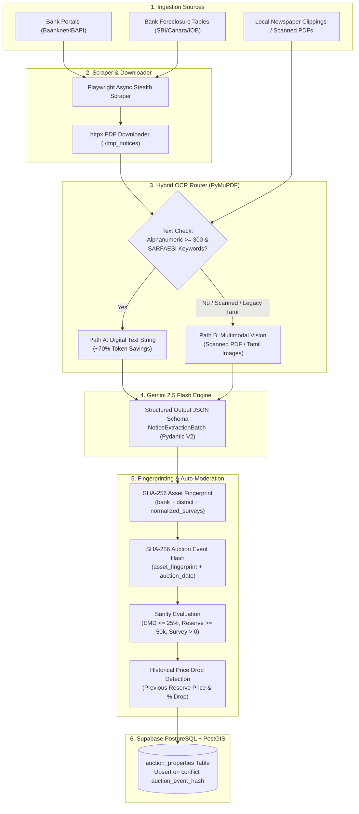

# Bank Auction Scraping & Multimodal OCR Microservice (`auction-ingestion-engine`)

A production-grade, fault-tolerant Python microservice for crawling public Indian bank auction portals (Baanknet/IBAPI, SBI, Canara Bank, IOB, C1 India), processing bilingual (Tamil + English) SARFAESI newspaper clipping images and PDFs, extracting structured property data via **PyMuPDF + Gemini 2.5 Flash Structured Outputs**, tracking repeat auction price drops, and upserting clean records into **Supabase (PostgreSQL + PostGIS)**.

---

## 1. System Architecture



---

## 2. Directory Structure

```text
auction-ingestion-engine/
├── .env.example               # Template for Gemini API keys, Supabase URLs, scraper configs
├── requirements.txt           # Production dependencies
├── README.md                  # System manual and architecture reference
├── config/
│   ├── __init__.py
│   └── settings.py            # Pydantic BaseSettings for runtime configs
├── models/
│   ├── __init__.py
│   └── auction_schema.py      # Pydantic V2 schemas (NoticeExtractionBatch, land unit converter)
├── scrapers/
│   ├── __init__.py
│   ├── base_scraper.py        # Playwright browser manager, stealth headers, async PDF downloader
│   ├── baanknet_scraper.py    # XHR/Fetch JSON interceptor + PDF notice fetcher for Baanknet
│   └── bank_notice_crawler.py # Direct PDF link crawler for bank foreclosure tables
├── ocr_pipeline/
│   ├── __init__.py
│   ├── pdf_router.py          # PyMuPDF digital text check vs. Multimodal Vision router
│   └── gemini_extractor.py    # google-genai SDK integration with strict JSON Schema output
├── database/
│   ├── __init__.py
│   ├── schema.sql             # PostgreSQL + PostGIS DDL with deduplication & price history
│   ├── fingerprint.py         # Deterministic SHA-256 hashes for asset identity & auction event
│   └── supabase_client.py     # Upsert logic, price-drop detection, and sanity auto-moderation
├── tests/
│   ├── __init__.py
│   └── test_pipeline.py       # Comprehensive pytest suite for schemas, conversions & hashes
└── main.py                    # CLI & Cron entry point (supports --mode, --input-dir, --dry-run)
```

---

## 3. Installation & Setup

### Prerequisites
- Python 3.10+
- (Optional) Playwright Chromium dependencies: `playwright install chromium`

### Install Dependencies
```bash
cd auction-ingestion-engine
pip install -r requirements.txt
playwright install chromium
```

### Environment Configuration
Copy `.env.example` to `.env` and supply your credentials:
```bash
cp .env.example .env
```

Edit `.env`:
```env
# Gemini API Key (Required for Multimodal Vision & extraction)
GEMINI_API_KEY=your_gemini_api_key_here

# Supabase Credentials (Required for database persistence)
SUPABASE_URL=https://your-project.supabase.co
SUPABASE_KEY=your_supabase_service_role_key

# Scraper & Engine Tuning
PLAYWRIGHT_HEADLESS=true
RATE_LIMIT_REQUESTS_PER_MINUTE=30
SCRAPE_STATE=Tamil Nadu
TMP_DOWNLOAD_DIR=./tmp_notices
LOG_LEVEL=INFO
```

---

## 4. Database Setup (Supabase)

Copy and execute the contents of [`database/schema.sql`](file:///c:/Users/rajkr/Documents/code-base/realstate/auction-ingestion-engine/database/schema.sql) in your **Supabase SQL Editor**:
- Enables `postgis` extension.
- Creates Enums: `asset_category_enum`, `possession_type_enum`, `review_status_enum`.
- Creates `auction_properties` table with `asset_fingerprint`, unique `auction_event_hash`, and automatic `updated_at` trigger.
- Creates composite index `idx_auction_district_status` and fingerprint index `idx_asset_fingerprint`.

---

## 5. CLI Usage & Operations

### A. Dry-Run Folder Ingestion (No Database Writes)
Inspect local notices (PDFs, JPGs, PNGs), run Gemini 2.5 Flash extraction, verify sanity, and output formatted Rich tables and JSON:
```bash
python main.py --input-dir ./sample_notices --dry-run
```

### B. Live Folder Ingestion into Supabase
Process all files in a folder and persist to Supabase:
```bash
python main.py --input-dir ./sample_notices
```

### C. Live Portal Web Scraping
Crawl live portals (Baanknet/IBAPI and bank foreclosure tables), download PDFs, extract data, and upsert records:
```bash
# Scrape all supported portals
python main.py --scrape-all

# Target specific portal
python main.py --mode=scrape --portal=baanknet
python main.py --mode=scrape --portal=canara
python main.py --mode=scrape --portal=iob
python main.py --mode=scrape --portal=sbi
```

---

## 6. Key Engineering Features

### 1. Hybrid OCR Routing (~70% Token Savings)
- **Path A (Digital Text PDF):** If PyMuPDF extracts `>= 300` alphanumeric characters and contains legal notice keywords (`reserve`, `emd`, `sarfaesi`, `survey`), plain text is sent to Gemini 2.5 Flash, saving ~70% token costs.
- **Path B (Vision / Legacy Font):** If character count is `< 300`, the file is an image, or non-Unicode Tamil legacy fonts (`Bamini`, `TAB`, `TAM`) are detected, raw bytes are streamed directly to Gemini Multimodal Vision.

### 2. Deterministic Deduplication & Repeat Auction Tracking
- **`asset_fingerprint`:** `SHA-256(clean_bank | clean_district | normalized_survey_numbers)`. Strips prefixes (`S.F. No.`, `SFNO`, `Survey No.`) and standardizes survey lists so `S.F. No. 124/2A, 125` matches `125, sfno 124/2a`.
- **`auction_event_hash`:** `SHA-256(asset_fingerprint | auction_date[YYYY-MM-DD])`. Ensures idempotent upserts across re-runs.
- **Price-Drop Calculation:** Before upsert, queries existing records for the same `asset_fingerprint` with an earlier `auction_date`. If found and the reserve price dropped, automatically computes `previous_reserve_price_inr` and `price_drop_percentage`.

### 3. Automated Sanity Moderation
Properties are auto-flagged as `NEEDS_MANUAL_REVIEW` if:
- `emd_amount_inr > reserve_price_inr * 0.25` or `emd <= 0` (standard SARFAESI EMD is ~10%).
- `reserve_price_inr < 50,000` (catches failed Lakh/Crore conversions).
- `survey_numbers` list is empty.
Otherwise, status is set to `PUBLISHED`.

### 4. Regional Land Area Conversions
Includes built-in conversion for Tamil Nadu real estate units:
- 1 Cent = 435.6 sq.ft
- 1 Ground = 2,400 sq.ft
- 1 Acre = 43,560 sq.ft
- 1 Hectare = 107,639 sq.ft
- 1 Sq. Meter = 10.7639 sq.ft

---

## 7. Running the Unit Tests

Execute the comprehensive test suite with pytest:
```bash
pytest tests/ -v
```
Verifies:
- Bilingual SARFAESI Pydantic schema validation.
- Area conversion logic for Cents, Grounds, Acres, and compound measures.
- Survey number normalization and SHA-256 fingerprint matching.
- Sanity auto-moderation rules.
- Repeat auction price drop calculation.
- Document router image handling.

