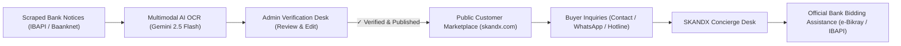
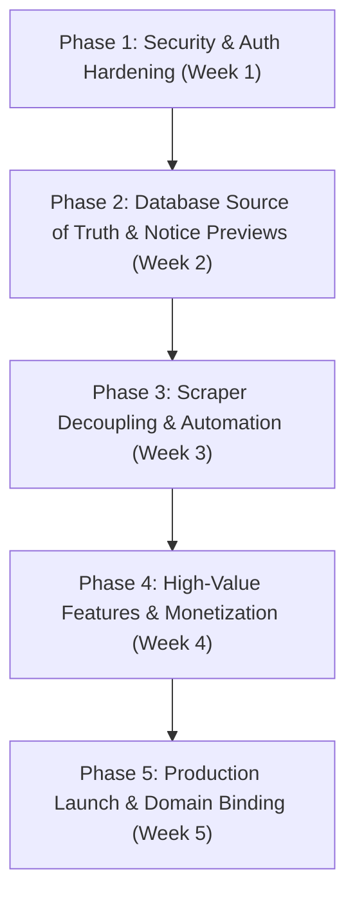

# SKANDX Platform Master Brief & Implementation Roadmap
  
> **Project**: SKANDX — Indian Bank Auction Discovery & Lead Concierge Platform  
> **Status**: Midway through Development (Architecture Hardened & Verified)  
> **Date**: November 2026  

---

## 1. Project Explanation: What is SKANDX?

### The Core Problem
Under the Indian **SARFAESI Act (2002)**, public and private sector banks (SBI, Canara, Bank of Baroda, ICICI, etc.) seize mortgaged properties from loan defaults and sell them via public auctions at **20% to 40% below market value**. 

However, everyday home buyers and property investors rarely participate because:
1. **Notices are scattered**: Published as chaotic scanned PDFs in regional print newspapers or buried across clunky government portals (IBAPI, e-Bikray, MSTC).
2. **Legal jargon is intimidating**: Terms like *Reserve Price*, *EMD (10%)*, *Physical vs. Symbolic Possession*, and *Section 14 CMM orders* confuse retail buyers.
3. **Third-party sites pretend to be bidding portals**: Private third parties cannot legally execute auction bids. Official bids can **only** happen on authorized government/bank portals after depositing the 10% caution deposit (Earnest Money Deposit - EMD).

### The SKANDX Solution
**SKANDX is not an eBay-style bidding site. It is India's premier Bank Auction Discovery and Assisted Concierge Platform.**

1. **Automated Scraping & AI OCR**: Automated Playwright crawlers pull regional auction tenders, while **Gemini 2.5 Flash Vision OCR** extracts reserve prices, survey numbers, EMD deadlines, and possession status.
2. **Admin Verification Desk (`admin.skandx.com`)**: Scraped listings land in a `PENDING_REVIEW` queue. Bank recovery officers review OCR data against the original circular, correct errors, and approve them.
3. **Customer Marketplace (`skandx.com`)**: Public buyers only see **`✓ Verified`** properties. Instead of a misleading "Bid Now" button, every property features a **"Contact"** button to request title packs, schedule site visits, or connect with a dedicated auction concierge.

---

## 2. Current Status: How It's Going

We are currently **50% through development**. The core foundation, UI design system, backend REST API, and data security models are completely built and passing tests.

### Completed Milestones (The First 50%)

| Component | Status | Key Features Delivered |
| :--- | :---: | :--- |
| **Frontend SPA** | ✅ **100% Done** | React 19 + Vite with dark luxury navy/gold design system. Responsive layout, budget filters, property cards with verified badges, and search overlays. |
| **Subdomain Routing** | ✅ **100% Done** | [domain.js](file:///c:/Users/rajkr/Documents/code-base/real%20estate/frontend/src/utils/domain.js) automatically serves the Marketplace on `skandx.com` and the Back-Office Desk on `admin.skandx.com` (with `/#admin` dev override). |
| **Lead Capture & UX** | ✅ **100% Done** | [ContactModal.jsx](file:///c:/Users/rajkr/Documents/code-base/real%20estate/frontend/src/components/Modals/ContactModal.jsx) with in-modal Step-2 confirmation, generated Reference IDs (e.g. `#SK-8492`), callback ETA (*"Within 15 minutes"*), and 1-click WhatsApp. |
| **Backend REST Server** | ✅ **100% Done** | [backend/app.py](file:///c:/Users/rajkr/Documents/code-base/real%20estate/backend/app.py) with HMAC-SHA256 cryptographic admin token authentication, 10MB payload limit, CORS headers, and thread-locked persistence. |
| **Ingestion Engine** | ✅ **100% Done** | Multimodal OCR engine ([gemini_extractor.py](file:///c:/Users/rajkr/Documents/code-base/real%20estate/backend/ingestion/ocr_pipeline/gemini_extractor.py)), PyMuPDF router, and Pydantic validation schemas. All 9/9 unit tests pass in 1.63s. |
| **Cloud Hosting Setup** | ✅ **Configured** | Vercel configured for frontend (`frontend/vercel.json`), Docker container configured for backend (`backend/Dockerfile`). |
| **Audits & Quality** | ✅ **Passed** | Ponytail Code Quality Audit passed; EGM Goldfish Review protocol Stages 5–8 completed with zero remaining architectural blockers. |

---

## 3. What Things We Need to Rectify Fully (Technical Debt & Fixes)

During our EGM architecture and design audits, we uncovered critical items that must be resolved to make the system 100% rock-solid before launching to real users.

### 🔴 Critical Fixes (Must Fix Before Public Users Enter)

1. **Unify Frontend-Backend Auth Handshake**:
   - *Problem*: In [AdminLoginView.jsx](file:///c:/Users/rajkr/Documents/code-base/real%20estate/frontend/src/views/AdminLoginView.jsx), login checks are done in client-side state and generate a 3-segment token (`skandx-adm-${Date.now()}`). The backend expects a 4-segment HMAC token signed by the server. When the admin clicks "Verify", the backend rejects it with 401, but the frontend masks it with a fake green toast.
   - *Rectification*: Update `AdminLoginView.jsx` to call `POST /api/admin/login` directly and store the server's signed HMAC token. Remove all try-catch masks in `api.js` that fake success.

2. **Purge Client-Side Plaintext Credentials**:
   - *Problem*: The demo admin credentials (`admin@skandx.com` / `skandx@admin2026`) are currently compiled directly into the client JavaScript bundle.
   - *Rectification*: Remove plaintext passwords from client code. Authenticate strictly against backend environment variables (`ADMIN_EMAIL`, `ADMIN_PASSWORD`, `ADMIN_JWT_SECRET`).

3. **Decouple the Web Scraper from the Web API Container (Render OOM Prevention)**:
   - *Problem*: When an admin clicks "Trigger Scraper", `backend/app.py` runs Playwright Chromium inside the API web server. Headless Chromium consumes 600MB–1.2GB RAM. On Render's 512MB free tier, the Linux kernel kills the container (`SIGKILL 137`), taking down the entire website.
   - *Rectification*: Move `ingestion/main.py` out of the web container. Run crawlers as a daily scheduled **GitHub Actions workflow** or a separate background worker container that writes directly to Supabase.

4. **Eliminate Ephemeral File Dual-Writes (Zero Lead Loss)**:
   - *Problem*: When a lead arrives, `backend/app.py` writes to local `leads.json` on disk. When Render restarts or redeploys, this file is deleted. If the Supabase write fails, the error was ignored.
   - *Rectification*: Make **Supabase PostgreSQL the single source of truth**. If the database write fails, return HTTP 500 so the frontend saves the lead into browser `localStorage` and retries automatically.

5. **Split the Production Bundles (True Admin Isolation)**:
   - *Problem*: Currently, public visitors on `skandx.com` download the admin desk JavaScript code in their browser bundle, accessible by typing `#admin`.
   - *Rectification*: Use Vite code-splitting (`React.lazy(() => import('./views/AdminView'))`) so administrative code chunks are only downloaded after successful login.

6. **Add Source PDF Preview in Admin Verification**:
   - *Problem*: Bank officers reviewing OCR listings in `AdminView.jsx` currently cannot see the original newspaper PDF or circular image to cross-check numbers.
   - *Rectification*: Add a split-pane or "View Original Notice" button linking to the source PDF URL in Supabase Storage.

---

## 4. Implementation Plan: The Remaining 50%

Here is the exact step-by-step roadmap to take SKANDX from its current midway state to a fully launched, monetized platform:

### Phase 1: Security & Auth Hardening (Immediate Priority)
- [ ] Connect [AdminLoginView.jsx](file:///c:/Users/rajkr/Documents/code-base/real%20estate/frontend/src/views/AdminLoginView.jsx) to `POST /api/admin/login` (real HMAC tokens).
- [ ] Remove hardcoded credentials from the client JS bundle.
- [ ] Lazy-load `AdminView` and `AdminLoginView` with Vite dynamic imports.
- [ ] Add rate-limiting on `POST /api/contact` to prevent lead form spam.

### Phase 2: Database Durability & Verification Desk Polish
- [ ] Create `customer_leads` table in Supabase PostgreSQL with RLS policies.
- [ ] Deprecate `data/leads.json` and `data/auctions_data.json` local file dual-writes.
- [ ] Add offline queue fallback in frontend `localStorage` if backend is momentarily sleeping.
- [ ] Add "View Original Notice PDF" link in the Admin Verification queue.
- [ ] Purge vestigial `BiddingModal.jsx` and mock bid state from `App.jsx`.

### Phase 3: Scraper Decoupling & Scheduled Ingestion
- [ ] Set up a `.github/workflows/daily_crawler.yml` GitHub Action to run `python -m ingestion.main --scrape-all` every night at 2:00 AM IST.
- [ ] Remove in-process Playwright Chromium dependencies from the main web API container (reducing container RAM footprint from 800MB to under 90MB!).
- [ ] Add daily Gemini token usage circuit breakers to prevent unexpected API costs.

### Phase 4: High-Leverage Monetization Features (Derived from Baanknet Blueprint)
- [ ] **Possession Risk Badge**: Display **"Physical Vacant Possession"** (Instant Handover) vs. **"Symbolic Possession"** (Litigation Warning) prominently on all cards.
- [ ] **Pre-Auction Bridge Loan Calculator (Level 4 Monetization)**: Help buyers calculate whether they can settle the mandatory 75% balance within SARFAESI's 15-day deadline.
- [ ] **Price-Drop Radar Alerts (Level 1 & 3 Monetization)**: Automatically detect when an auction notice re-appears with a 10%–20% reserve price reduction and push alerts to registered investor WhatsApp numbers.

### Phase 5: Production Domain Launch
- [ ] Bind custom domain `skandx.com` on Vercel for the public marketplace.
- [ ] Bind `admin.skandx.com` CNAME on Vercel for the back-office desk.
- [ ] Bind `api.skandx.com` to Render Docker web service.
- [ ] Execute end-to-end smoke test: Scrape Notice &rarr; Admin Verification &rarr; Marketplace Display &rarr; Buyer Inquiry &rarr; Lead Record in Supabase.

---

## 5. Summary Cheat-Sheet

| What SKANDX Is | What SKANDX Isn't |
| :--- | :--- |
| A curated, verified bank auction discovery catalog | A live eBay-style bidding exchange |
| An assisted concierge connecting buyers to recovery officers | An anonymous broker charging 2% commission |
| A legal intelligence filter (Physical vs Symbolic possession) | An unverified scraper dumping raw unverified text |
| A lightweight lead acquisition engine for banks & investors | A heavy, monolithic slow-loading web server |
